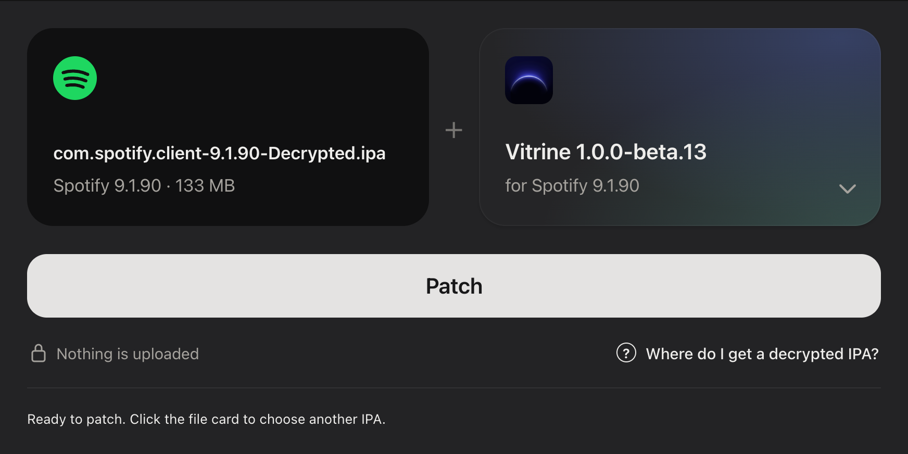

# Spotify Patcher

### Your Spotify IPA, patched in a few clicks.

**Spotify Patcher** is a Mac app that helps you prepare a decrypted Spotify IPA with **Vitrine** or **Chroma**. Drop in your file, choose a mod, and click **Patch**. The app handles the build, checks the result, and puts the finished IPA where you can find it.

**[Download Spotify Patcher for Mac](https://github.com/pipelinear/spotify-patcher/releases/latest)** · Apple silicon · macOS 13+



## Install the app

1. Download the **DMG** from the [latest release](https://github.com/pipelinear/spotify-patcher/releases/latest).
2. Open it and drag **Spotify Patcher.app** to **Applications**.
3. Open Spotify Patcher. This release is not notarized, so macOS may block the first launch. If it does, try opening it once, then go to **System Settings → Privacy & Security → Open Anyway**. [Apple explains this first-open step](https://support.apple.com/en-lamr/102445).

The release also includes a ZIP containing the app if you prefer that format. You do not need to run the source build command to use the downloaded app.

## Why use Spotify Patcher?

- **One clear workflow.** Select your IPA and mod in the same window, then follow readable progress updates.
- **Choose the project you want.** Build the latest Vitrine from GitHub or apply Chroma's latest official stable release kit.
- **Keep your original file.** Patching happens locally on your Mac; your input IPA is left untouched and is never uploaded by Spotify Patcher.
- **Know what you got.** The app validates the input and finished IPA, then saves a SHA-256 checksum and build record alongside the output.
- **Find the result fast.** Click **Open download folder** to reveal the patched IPA in `~/Downloads/Spotify Patcher/`.
- **Get help along the way.** The built-in tutorial walks through getting a decrypted IPA, patching it, finding the result, and installing it with Sideloadly.

## From IPA to iPhone

1. Open **Spotify Patcher** on an Apple silicon Mac.
2. Drop in an original, decrypted Spotify `.ipa` or click the file card to choose one.
3. Select **Vitrine** or **Chroma**, then click **Patch**.
4. Open the download folder when the app reports **Patched and verified**.
5. Sign and install the patched IPA on your iPhone with [Sideloadly](https://sideloadly.io/). The app's **Tutorial** tab explains each step.

Your patched IPA still needs signing before it can run on an iPhone. A free Apple ID's sideloaded app typically needs to be installed again after seven days. Spotify Patcher keeps the patched IPA so you can repeat that installation step.

## Pick the mod that fits you

| | Vitrine | Chroma |
| --- | --- | --- |
| Source | Builds the latest [Vitrine](https://github.com/My-Name-Is-Jeff/vitrine) from GitHub | Applies the latest official stable [Chroma](https://github.com/skopevoj/spoti.pw) release kit |
| Access | Free community fork | Free features and a paid Plus tier |
| Setup | Requires full Xcode with the iOS 26+ SDK and build tools | Requires a Spotify version supported by the release kit |

The **About** tab compares features and links to the projects' documentation. Chroma Plus and Spotify Premium are separate subscriptions; Spotify Patcher does not provide either one.

## Requirements

- Apple silicon Mac running macOS 13 or newer.
- An original, decrypted Spotify IPA compatible with your chosen mod.
- Internet access to fetch the selected project and any needed build tools.
- For Vitrine builds: full Xcode with an iOS 26+ SDK. Spotify Patcher checks for required command-line tools and uses Homebrew to install missing ones when available. The first build can take longer.
- Sideloadly or another signing method to install the output on your iPhone.

## Build from source

From this directory, run:

```bash
bash build-app.sh
```

The build creates `../Spotify Patcher.app`. It is signed locally for development and is not notarized. The app uses a native AppKit window with a local WebKit interface; `backend.py` performs validation, patching, verification, and output saving. Build logs are kept at `~/Library/Caches/VitrinePatcher/last-build.jsonl`.
